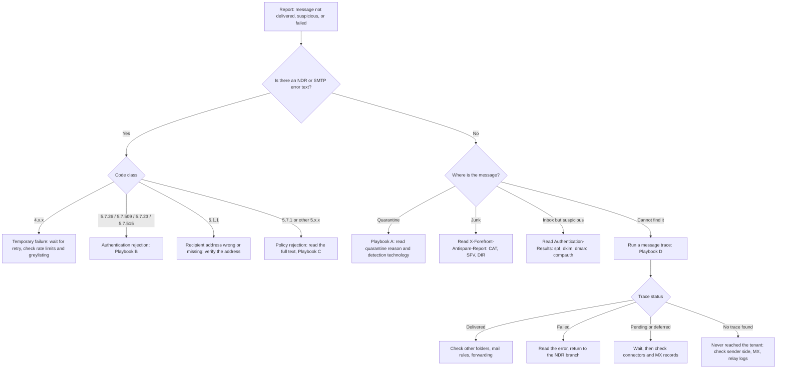

# Email Authentication and Delivery Runbook

Troubleshooting guide for mail flow and authentication problems on a Microsoft 365 tenant with a custom domain. Built from a home lab, so every result marked **observed** was seen in this lab's own evidence. Anything marked **documented** comes from vendor documentation and was not tested here.

**Lab setup:** Microsoft 365 Business Standard trial, domain `jon-maillab.org` with DNS at Cloudflare, SPF and DKIM (`selector1`) for Microsoft 365, DMARC reports to a lab mailbox, and SMTP2GO as an unauthorized relay for spoofing tests.

---

## 1. First five minutes: collect before you diagnose

Get these before changing anything:

1. The **exact error text** (NDR body, SMTP2GO or sender log entry, or the message trace status).
2. The **full message header** (Gmail: Show original; Outlook: Message details).
3. The **time in UTC**. Microsoft 365 traces and DMARC reports use UTC, while mail clients show local time.
4. **Sender, recipient, and direction** (inbound, outbound, or internal).
5. Whether this is **new** (a recent DNS or policy change) or **long-standing**.

Do not edit DNS until you know which check failed. Changing records mid-investigation mixes old and new results.

---

## 2. Decision tree



---

## 3. Playbooks

### Playbook A: message quarantined or sent to Junk

1. Defender portal: **Email & collaboration > Review > Quarantine**. Search by subject or sender.
2. Open the entry and record: **Quarantine reason**, **Policy type**, and **Detection technologies**.
3. Match what you see:

| Detection technology | Meaning | Observed |
|---|---|---|
| Spoof DMARC | The anti-phishing policy honored the sender domain's DMARC policy (`quarantine` or `reject`) | Yes, at `p=quarantine`: reason Phish, policy type Anti-phishing policy, action Blocked |

4. For the header, read `X-Forefront-Antispam-Report`. Use `CAT:` (category) and `DIR:` (direction) to see what Microsoft decided. Microsoft recommends these over SCL in cloud organizations.
5. Release only after you have confirmed the sender is legitimate. A released spoof stays released.

### Playbook B: authentication failures (SPF, DKIM, DMARC)

1. Find `Authentication-Results:` in the header. In Gmail, use the line that starts with `mx.google.com` (not the ARC lines).
2. Read `spf=`, `dkim=`, `dmarc=`, and the domains they refer to.
3. **Check alignment, not only pass or fail.** DMARC passes only if SPF or DKIM passes **and** its domain matches the `From:` domain.

| Pattern | Meaning | Status | Fix |
|---|---|---|---|
| `spf=pass` (for a relay's domain), `dkim=pass` (`d=` is the relay's domain), `dmarc=fail` | Third-party sender authenticates as itself, not as your domain | Observed (SMTP2GO relay) | Set up a custom return-path and DKIM signing for your domain at the sender, or stop sending as your domain |
| `spf=pass`, `dkim=pass` (`d=jon-maillab.org`), `dmarc=pass` | Legitimate mail through Microsoft 365 | Observed | None |
| `dkim=none`, `dmarc=none`, mail between mailboxes in the same tenant | Internal mail is not signed or DMARC-checked | Observed | None |
| `spf=fail`, `dkim=pass` (aligned), `dmarc=pass` | SPF broken but DKIM carries DMARC | Confirm against your SPF-break evidence | Repair SPF, but delivery was not affected |
| `compauth=fail reason=601` | Sending domain is an accepted domain in your tenant (self-to-self spoofing) | Observed | Authenticate the sender or block it |
| `compauth=fail reason=010` | DMARC failed under a quarantine or reject policy for your own accepted domain | Documented, not observed | Same as above |

4. Check the records directly:
   ```
   nslookup -type=TXT jon-maillab.org 1.1.1.1
   nslookup -type=TXT _dmarc.jon-maillab.org 1.1.1.1
   nslookup -type=CNAME selector1._domainkey.jon-maillab.org 1.1.1.1
   ```
   Check against a second resolver (8.8.8.8) before concluding that a change has propagated.
5. After any fix, send a test message and re-read the header. Do not trust the DNS change alone.

### Playbook C: rejected with a 5xx error

1. Read the **whole** error string, not just the code. The text often names the failed check.
2. Look the code up in section 5.
3. If the sender is a service you control (relay, marketing platform, CRM), look at its delivery log. In the lab, SMTP2GO's Activity log showed Gmail's full refusal text, while the sending client showed only success.
4. Note that the rejection notice goes to the **envelope sender** (Return-Path), not to the `From:` address. In the lab it went to the relay's bounce address, not to the person being impersonated.

### Playbook D: message cannot be found

1. Exchange admin center: **Mail flow > Message trace**. Search by sender and recipient over the right UTC window.
2. Read the status and open the event list: **Receive**, **Fail**, **Deliver**, **Send external**.
3. Interpret:
   - **Delivered:** the tenant handed it off. Check other folders, rules, and forwarding.
   - **Failed:** read the error text and use section 5.
   - **Pending or deferred:** retries are in progress. Check connectors and MX records.
   - **No trace:** it never reached the tenant. Check the sender side and MX.

### Playbook E: changing a DMARC policy safely

1. Record the **exact time** of each change, in UTC.
2. Keep the `rua=` tag. Without it you get no reports.
3. Move up in steps: `p=none`, then `p=quarantine` at a low `pct`, then `p=reject`. Read the reports between steps.
4. Wait for DNS to propagate (check two resolvers) before testing.
5. Test one **legitimate** message from every real sending source after each change.
6. Do not restore the old policy while a sender is still retrying messages. A retry is evaluated under whichever policy is live when it lands.

---

## 4. Reading a header: quick reference

| Field | What it tells you |
|---|---|
| `Authentication-Results` | The receiver's own SPF, DKIM, and DMARC verdicts |
| `smtp.mailfrom` / `Return-Path` | The envelope sender, which SPF checks and where bounces go |
| `header.from` | The domain DMARC protects |
| `header.d` / `d=` (DKIM) | The domain that signed |
| `dis=` (Google) | The disposition applied: `NONE`, `QUARANTINE`, `REJECT` |
| `compauth` / `reason` (Microsoft) | Composite authentication result and its reason code |
| `X-Forefront-Antispam-Report` | `CAT` (category), `DIR` (direction), `SFV` (spam filter verdict) |

---

## 5. NDR and SMTP code reference

**Observed in this lab:**

| Code | Source | Text (abridged) | Cause |
|---|---|---|---|
| `550 5.7.26` | Gmail | Unauthenticated email from the domain is not accepted due to its DMARC policy | DMARC failed and the domain published `p=reject`. Returned during the SMTP session. |
| `550 5.7.509` | Microsoft 365 | Access denied, sending domain does not pass DMARC verification and has a DMARC policy of reject | Same cause, Microsoft's code |

**Documented, not tested in this lab** (verify against Microsoft's current NDR reference before relying on it):

| Code | Typical meaning |
|---|---|
| `5.7.23` | SPF validation failed; sending IP not authorized by SPF |
| `5.7.515` | Sending domain does not meet the required authentication level (Outlook.com high-volume sender rules) |
| `5.7.511` | Sending IP is banned |
| `5.7.1` | Generic policy refusal; read the full text, since many unrelated causes use it |
| `5.1.1` | Recipient address does not exist |
| `4.x.x` | Temporary failure; the sender normally retries |
| `5.x.x` | Permanent failure; retrying will not help until something changes |

---

## 6. Lab evidence: the same forged message under three policies

One message per policy, from an unauthorized relay (SPF and DKIM passed for the relay's own domain, neither aligned), default settings in a trial tenant. The finding does not generalize beyond that.

| `_dmarc` policy | Gmail | Microsoft 365 (Bob) |
|---|---|---|
| `p=none` | Inbox, `dis=NONE` | Inbox, `compauth=fail reason=601` |
| `p=quarantine` | Spam, `dis=QUARANTINE` | Quarantined, detection technology Spoof DMARC |
| `p=reject` | Refused during SMTP, `550 5.7.26` | Not delivered, `550 5.7.509` |

**Control:** mail from Alice through Microsoft 365 to Gmail passed SPF, DKIM, and DMARC (all aligned) under `p=quarantine`, both before and after the `p=reject` test.

---

## 7. Not tested in this lab

- Subdomain policy (`sp=`) behavior with a differing value
- Partial enforcement (`pct` below 100) over many messages
- Forwarding and mailing lists (SPF breakage, ARC)
- Multiple third-party senders sharing one domain
- Behavior in a tenant with customized anti-phishing or spoof-intelligence settings

## 8. Production notes

- A lab with one sender is easy. In production, inventory every system that sends as your domain **before** moving to `quarantine` or `reject`.
- Rejection notices from forged mail go to the forger's return path, so your own users never see them. Aggregate reports are how you see the volume.
- Keep an owner and a rollback plan for each DNS change, and keep the previous record value in a ticket.
